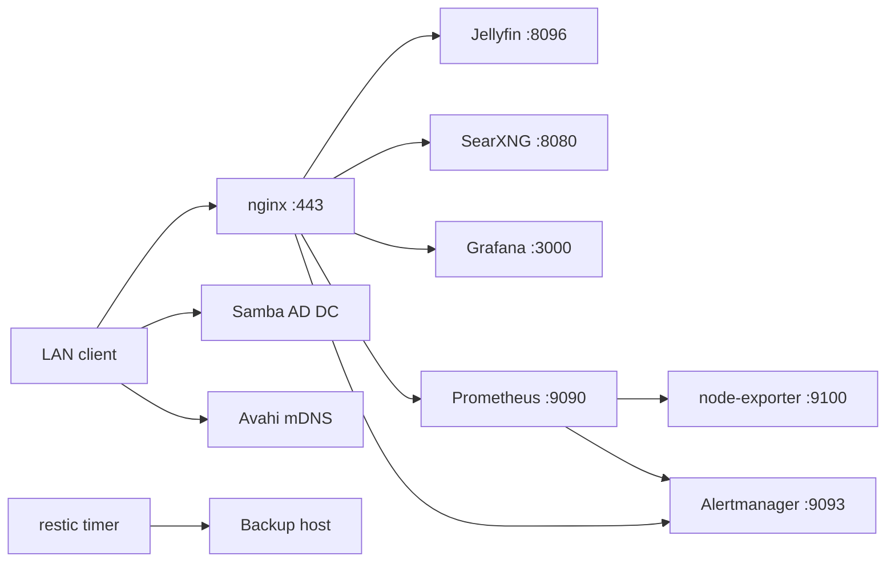
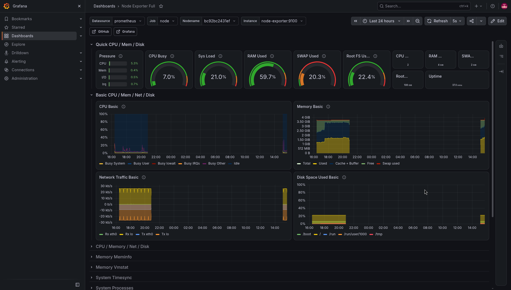
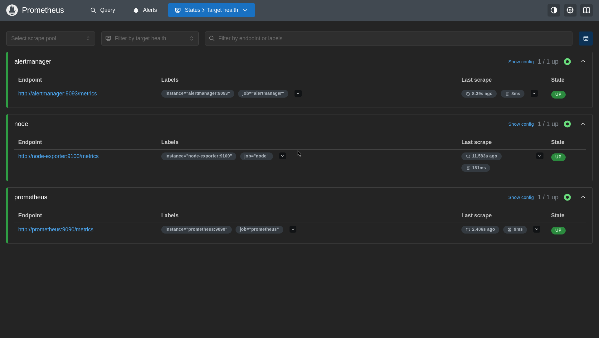
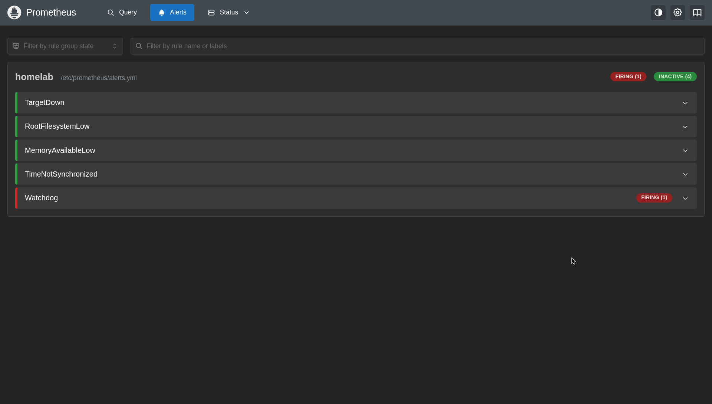
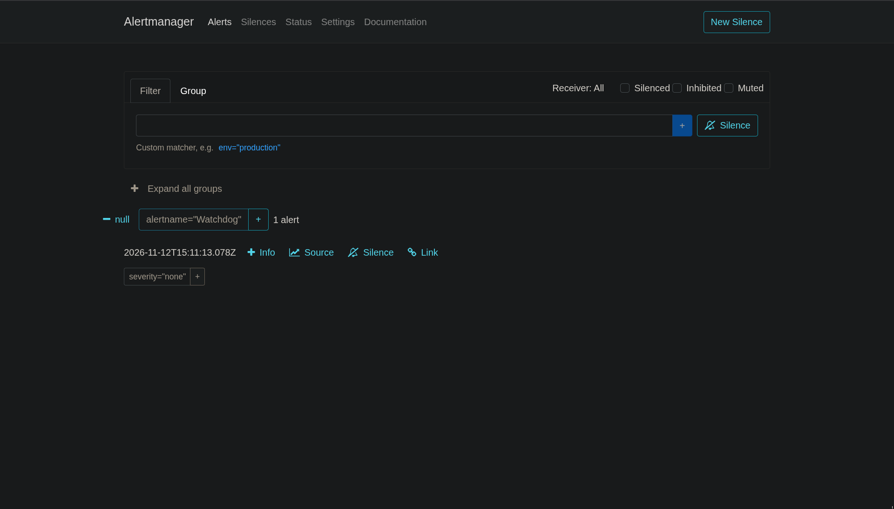

# Homelab

One old laptop, Arch Linux, Docker, and a small set of services I actually
use. The lab is deliberately small. It is a place to practise the parts of IT
support that are easy to read about and annoying to fix for real: DNS that
half-works, a certificate clients do not trust, a container that starts but
is not reachable, and a backup that nobody has restored yet.

In plain terms: I run a small server at home, keep the services separated, put
HTTPS in front, monitor them, back them up and write down what breaks. It is a
personal learning environment, not production.

The public copy is sanitized. Real hostnames, IP addresses, user names, AD
realm, certificate names, backup IDs and private paths are replaced with
placeholders.

## At a glance

| Item | Value |
|---|---|
| Host | Arch Linux, headless, 2 cores, about 3.7 GiB RAM |
| Container runtime | Docker with 7 pinned Compose projects |
| Host ports | 80 and 443, published by nginx only |
| Web services | Jellyfin, SearXNG, Grafana, Prometheus, Alertmanager |
| Identity | Samba AD DC, Windows 2008 R2 functional level |
| Monitoring | Prometheus, Grafana, Alertmanager, node-exporter |
| Backup | restic to a separate host, daily at 20:00 |
| LAN discovery | Avahi with private `.local` names |
| Last verified | 2026-10-20 |

The status below comes from checks on the host, not from a mock-up. A 302
from Grafana, Prometheus or Jellyfin is a redirect to the login or web UI, not
a failure.

## What is running

| Service | What it does | State |
|---|---|---|
| nginx | TLS reverse proxy and HTTP redirect | 1.30.6, ports 80/443, self-signed certificate |
| Jellyfin | Media server | 10.11.11, two series and 23 episodes indexed from a read-only SMB share |
| SearXNG | Private search | 2026.10.19 build, no limiter, not public |
| Grafana | Dashboards | 13.2.4, admin password in untracked `.env` |
| Prometheus | Metrics collection | v3.15.0, 15-second scrape, five alert rules loaded |
| Alertmanager | Alert routing | v0.34.1, Watchdog dead man's switch, no external receiver |
| node-exporter | Host metrics | v1.12.1, SMART and temperature textfile every 5 minutes |
| Samba AD | DNS, Kerberos, LDAP and SMB for the lab | Active, anonymous access restricted, functional level 2008 R2 |
| Avahi | Private `.local` aliases | Active, verified from the host and Android |
| restic | Backup | Daily timer, separate backup host, no offsite copy |

The application containers use the shared external `homelab` Docker network.
Only nginx publishes host ports. Samba AD, Prometheus and Alertmanager are
reachable from the private LAN only.

## Architecture



Only nginx has host port mappings. The other containers are on the internal
Docker network and are reached through the proxy or directly on the private
LAN.

## Screenshots

Real screenshots from the running host, taken on 2026-11-12. The UI language is
Czech because that is how the host is configured.

| Grafana | Prometheus |
|---|---|
|  |  |
|  |  |

All screenshots with captions are in
[`docs/screenshots/`](docs/screenshots/README.md).

## What changed

The starting point was not clean. The old public README described a working
stack while the containers had been stopped, secrets were handled
inconsistently, and there was no backup. This pass was mostly about making the
host and the documentation agree.

| Area | Before | Now |
|---|---|---|
| Documentation | Claimed services were running | Status reflects checks and lists what is still broken |
| Docker | Stack stopped, old Compose file | 7 pinned projects, shared network, only nginx publishes 80/443 |
| Secrets | Default or unclear handling | Real secrets untracked, mode 600, examples committed |
| Backup | None | restic timer to a separate host, no offsite copy yet |
| mDNS | Unreliable | Avahi `.local` works from the host and Android; NixOS deferred |
| Samba | Anonymous access possible | `restrict anonymous = 2`, password policy applied |
| `/boot` | World-accessible paths | 0077 masks, 700 permissions, no group/other access |
| Updates | Ad hoc | `checkupdates`, `arch-audit`, Lynis, `paccache`, written policy |
| Jellyfin | No media | Two series, 23 episodes, read-only SMB share, TMDb metadata |

The full sequence, including the mistakes and rollbacks, is in
[`docs/build-log.md`](docs/build-log.md).

## Verification snapshot

| Check | Result |
|---|---|
| Docker service | Active |
| nginx | Ports 80 and 443, health endpoint answers |
| Five private HTTPS vhosts | 200 or 302 on 2026-10-20 |
| Samba AD service | Active, AD ports listening |
| Avahi | Active, UDP 5353 listening |
| fail2ban | Active |
| SSH password authentication | Disabled in the server configuration |
| nftables | Enabled, oneshot service loaded successfully |
| Backup timer | Enabled, next run at 20:00 plus up to 15 minutes |
| Node metrics timer | Enabled, runs every 5 minutes |
| Installed vulnerabilities | 7 reported, no fixed versions offered at the last check |
| NTP target | Not met over Wi-Fi |
| Offsite backup | Not configured |
| Restore drill | Not recorded |

I did not reboot after the `/boot` permission change. The mount options and
permissions were verified live, but a reboot test is still open.

## Problems that taught me the most

**`.local` is not the same as `.home`.** The old setup used `.home` names in
nginx and in the certificate, but no DNS zone resolved them. The working path
is Avahi and `.local`. I did not add a `.home` zone just to keep the old names
alive. The legacy names are still a known loose end.

**Wi-Fi is a bad clock source.** The NTP target was less than 0.1 s offset
and less than 0.05 s jitter. The link could not hold that. Measured samples
were around -0.113 s offset with 16.766 s jitter, and earlier -0.267 s with
5.617 s jitter. I stopped pretending the target was met and wrote the real
numbers down.

**vfat does not give you 600 with `fmask=0077`.** I expected 600 for files on
`/boot`. The first remount did not apply the masks, the second attempt was
rolled back because the check expected 600, and the final state is 700 for the
mount root and the random-seed file. There is no group or other access, which
was the actual goal. Exact 600 would need a different mask and a different
policy.

**`smbd` being inactive does not mean Samba is down.** This is an AD DC. The
service is `samba.service`; `smbd`, `nmbd` and `samba-ad-dc` can be inactive
while the AD services are running. Anonymous SMB access is supposed to fail
with `NT_STATUS_ACCESS_DENIED`.

**Docker socket access is not a convenience feature.** The login user is not
in the `docker` group. That is intentional. I use a root shell or the
systemd-managed service for Docker work instead of widening the account.

These and a few smaller cases are in
[`docs/troubleshooting.md`](docs/troubleshooting.md).

## Security notes

The useful parts are not complicated. SSH password login is off, fail2ban is
active, nftables is enabled, containers run with `no-new-privileges`, resource
limits and health checks, and the real secrets stay out of Git. Images are
pinned; nothing uses `latest`.

The honest gaps matter more:

- Seven installed packages are reported vulnerable. `libxml2` and `pam` are
  High. At the last check, `arch-audit -u` offered no fixed versions. They are
  not patched.
- There is no offsite backup, and the old AD dumps are not automatically
  deleted. A full restore has not been performed.
- NTP precision is not good enough over Wi-Fi.
- The NixOS client mDNS setup is deferred.
- Samba AD is still at the Windows 2008 R2 functional level.
- There is no public ingress or remote-access VPN.

I am not claiming this is fully hardened. The open items are in
[`docs/audit-2026-10.md`](docs/audit-2026-10.md).

## If you are reviewing this repo

The most useful pages for an IT support or junior sysadmin role are probably:

1. [`docs/build-log.md`](docs/build-log.md): what I did, in order, including
   the parts that failed. It covers Linux service management, Docker Compose,
   DNS and mDNS, TLS, Samba AD, systemd timers, backups and troubleshooting.
2. [`docs/troubleshooting.md`](docs/troubleshooting.md): symptom, checks,
   cause and fix.
3. [`docs/audit-2026-10.md`](docs/audit-2026-10.md): what the audit found and
   what I did not fix.
4. [`docs/decisions.md`](docs/decisions.md): why the stack looks like this.

The configuration is in `nginx/`, `monitoring/`, `jellyfin/`, `searxng/`,
`samba/`, `mdns/` and `backup/`. The real values are not here; the structure
and the security-relevant settings are.

## Repository map

```text
.
├── README.md
├── LICENSE
├── .gitignore
├── backup/                 sanitized systemd units for restic
├── docs/
│   ├── audit-2026-10.md
│   ├── backup.md
│   ├── build-log.md
│   ├── decisions.md
│   ├── https.md
│   ├── media-share.md      SMB share, CIFS mount and the Jellyfin library
│   ├── samba-ad.md
│   ├── screenshots/        Grafana, Prometheus and SearXNG screenshots
│   ├── troubleshooting.md
│   └── update-policy.md
├── hardening/              SSH, nftables and fail2ban notes
├── jellyfin/               pinned Compose file
├── mdns/                   Avahi alias template
├── monitoring/             per-service Compose files and configs
├── nginx/                  reverse proxy and certificate notes
├── samba/                  sanitized `smb.conf` example
└── searxng/                Compose file and settings example
```

## Running it

The outline is the same on a fresh host:

1. Create the external Docker network `homelab`.
2. Copy the example environment and settings files, generate unique secrets,
   and keep the real files mode 600 and untracked.
3. Put the private TLS certificate and key in `nginx/certs/`.
4. Create the application data directories and the read-only media mount.
5. Start each Compose project from its directory with `docker compose up -d`.
6. Check `docker compose ps`, the nginx health endpoint and the private HTTPS
   names.
7. Check the backup timer and run a restore test before trusting the backup.

The real deployment uses root-managed services and private values that are not
part of this repository. Do not expose the AD ports, the Docker application
ports or the monitoring UIs to the internet.

## License

MIT. See [LICENSE](LICENSE).
