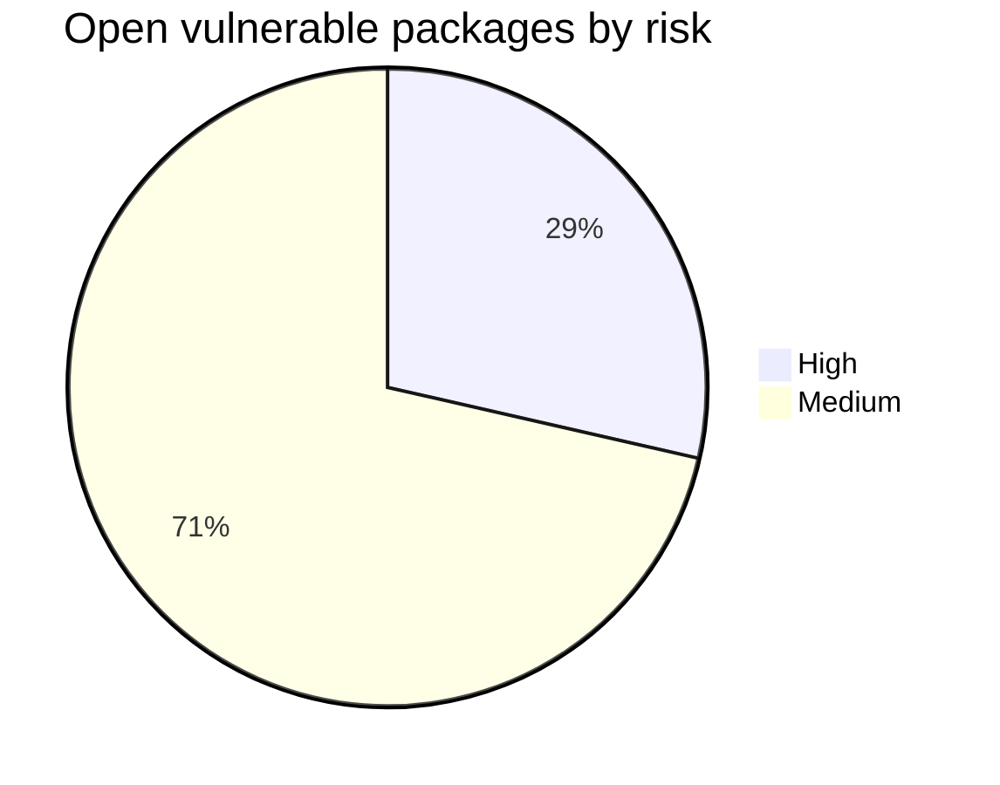

# Audit 2026-10

This is a snapshot of the host after the cleanup work. It is not a
certification and it is not the raw audit output. The raw evidence contains
private host information and stays outside this repository. No credential,
token, private key, repository ID or snapshot ID is included here.

The host is a small Arch Linux machine running Docker services, nginx, a Samba
AD DC, Avahi and restic. The starting point was rough: the old README
described a running stack while the containers were stopped, secrets were
handled inconsistently, there was no backup, and SMB allowed anonymous
access.

## What is working now

| Area | Result |
|---|---|
| Docker | Seven pinned Compose projects; Docker active; shared external `homelab` network |
| Ports | Only nginx publishes 80 and 443; applications use `expose` |
| Reverse proxy | Five private HTTPS vhosts answer; HTTP redirects to HTTPS; unknown hosts return 404 |
| Jellyfin | 10.11.11; first-run wizard complete; media library not documented |
| SearXNG | Private instance; generated secret; limiter disabled |
| Monitoring | Grafana, Prometheus, Alertmanager and node-exporter running; alert rules loaded |
| Samba AD | `samba.service` active; anonymous access restricted; password policy applied |
| Samba level | Windows 2008 R2; not raised in this work |
| mDNS | Avahi active; `.local` verified from the Arch host and Android |
| Backup | Local restic backup to a separate host; daily timer enabled; no offsite copy |
| `/boot` | `fmask=0077,dmask=0077`; directories 700; random-seed 700 on vfat; no world access |
| SSH | Password authentication disabled in the server configuration |
| Brute force | fail2ban active |
| Firewall | nftables enabled; only the required LAN ports are allowed |
| Secrets | Real `.env`, SearXNG settings, TLS key and restic password are untracked and mode 600 |
| Tooling | `checkupdates`, `arch-audit`, `lynis`, `paccache` installed; update policy written |

A 302 from Grafana, Prometheus or Jellyfin is a redirect to the login or web
UI. It is not an availability failure.

## Open findings

### Vulnerable packages

`arch-audit` reported seven installed packages on 2026-10-20.

| Package | Risk | Issue |
|---|---|---|
| `libxml2` | High | Denial of service: CVE-2025-6170, CVE-2025-49796, CVE-2025-49795, CVE-2025-49794 |
| `pam` | High | Arbitrary filesystem access: CVE-2025-6020 |
| `coreutils` | Medium | Information disclosure: CVE-2025-5278 |
| `linux` | Medium | Multiple issues and insufficient validation: multiple CVEs |
| `openssl` | Medium | Arbitrary command execution and certificate verification bypass: CVE-2022-2068, CVE-2025-4575 |
| `perl` | Medium | Signature forgery, directory traversal and unknown issues: CVE-2020-16156, CVE-2021-36770, CVE-2025-40909 |
| `systemd` | Medium | Information disclosure: CVE-2025-4598 |

`arch-audit -u` returned no entries. The current sync database offered no
fixed version for these packages, so they are not patched. The two pending
routine updates (`opencode` and `python-markdown`) were not security fixes for
this list, and I did not install them or run a full system upgrade during the
audit.

Lynis reported a hardening index of 66, 251 tests, one warning and 29
suggestions. The warning was the vulnerable-package finding. I do not treat
the index as a pass mark.

### Time sync

The target of less than 0.1 s offset and less than 0.05 s jitter is not met
over Wi-Fi. Observed samples included -0.113 s offset with 16.766 s jitter,
and earlier -0.267 s offset with 5.617 s jitter. The link is unstable. A single
good sample would not prove the target, and I am not claiming it is met.

### Backup

There is no offsite second copy. Old AD dumps are not automatically deleted.
A full restore drill is not recorded. The backup password and repository
identifier remain private.

The daily timer is enabled, but a timer is not a restore. Until a restore has
been tested, the backup is a work in progress.

### mDNS client coverage

The Arch host and an Android client work with `.local`. The NixOS client mDNS
setup is prepared but deferred. `systemd-resolved` must remain disabled
because Samba uses port 53 for its internal DNS.

### Legacy names and scope

Legacy `.home` names may remain in nginx and the certificate but do not
resolve. `.local` is the primary path. No router, DHCP or client DNS change
was made to support the legacy names.

Samba AD remains at the Windows 2008 R2 functional level. Raising it would be
a separate change with its own test plan.

Jellyfin is configured, but media library setup is not documented here. The
media tree was not changed beyond the approved test asset.

## Verification notes

The Docker socket is not available to the login user. Docker administration is
root-managed by design. This is a deliberate boundary, not a missing group
membership to fix.

`nftables.service` is a oneshot unit. It can show `inactive (dead)` after it
has loaded the rules successfully. That does not mean the firewall is off.

`smbd`, `nmbd` and `samba-ad-dc` can be inactive while `samba.service`
provides the AD DC. Anonymous SMB access is intentionally denied.

A normal user cannot list `/boot` because the mount root is 700. The vfat
files are 700, not 600; there is no group or other access.

The `/boot` change was verified live, but I did not reboot afterwards. A reboot
test is still open.

## Next checks

1. Recheck `arch-audit -u` weekly and apply fixed versions through a full
   upgrade when available.
2. Add an offsite backup copy and define AD dump retention.
3. Perform and document a restore drill.
4. Reboot once and recheck `/boot` and the boot entry.
5. Finish the NixOS mDNS client when it is in scope.
6. Decide whether to raise the Samba functional level and whether to remove
   the legacy `.home` names.
7. Add a media library only after an explicit media-scope decision.
