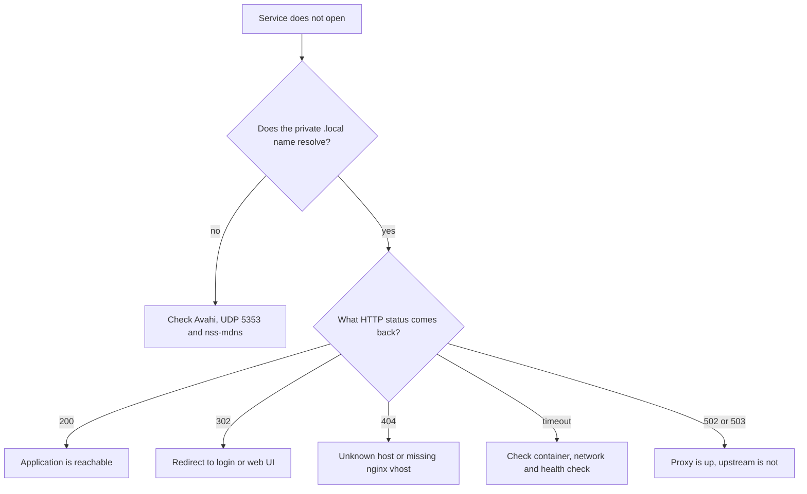

# Troubleshooting

I wrote this from the failures I actually hit in this lab. The private names
and addresses are replaced with placeholders. The first check is always name
resolution, then TLS, then HTTP status, then the container.

## A service is not reachable



Useful commands:

```bash
getent hosts <service>.local
curl -k -I https://<service>.example.test/
docker compose ps
systemctl is-active docker
```

A 302 from `/` is normal for Grafana, Prometheus and Jellyfin. A 404 from the
default nginx vhost usually means the request used a name that has no matching
server block.

## `.local` works, legacy `.home` does not

The old `.home` names were present in nginx and in the certificate, but no DNS
zone resolved them. I did not add a `.home` zone to rescue the old names.
Avahi and `.local` are the primary path now.

The useful test is from the same LAN, not from the host itself:

```bash
getent hosts <service>.local
curl -k https://<service>.local/healthz
```

If the name resolves but the request fails, move to the HTTP status checks
above. If the name does not resolve, check that Avahi is running, UDP 5353 is
allowed on the Wi-Fi interface, and the client has `nss-mdns`.

The legacy `.home` names are a known loose end, not a hidden success. They
should be removed or documented as unsupported.

## Android shows an error while the desktop works

An Android browser failure turned out to be mobile data, not the server. The
`.local` name was not reachable through the carrier path. Disconnect mobile
data, stay on the home Wi-Fi and retry.

I did not change router DHCP or client DNS to work around it. If a client on
the same Wi-Fi still fails, test another client before changing the server.

## The NTP target is not met over Wi-Fi

The target was less than 0.1 s offset and less than 0.05 s jitter. The Wi-Fi
link could not hold it.

Observed on 2026-10-20:

```text
offset: -0.113 s
jitter:  16.766 s
```

An earlier sample showed `-0.267 s` offset and `5.617 s` jitter. The link is
unstable, so one good sample does not prove the target. `systemd-timesyncd`
is disabled and `ntpd` is used.

If time is wrong, inspect the selected peer first. Do not run a blind step
adjustment during normal operation. If the precision actually matters, use a
wired link or a better clock source instead of pretending Wi-Fi is good
enough.

## NixOS mDNS client is deferred

The NixOS client does not have Avahi or the `mdns` NSS entry. A setup script
was prepared but not run. Do not assume `.local` discovery works there.

If the Android path works, use the IP-and-port fallback only as a temporary
client workaround. Do not add a `.home` zone or change the router to compensate
for an unfinished client.

## Docker says permission denied on the socket

The login user is not in the `docker` group. That is intentional. Use the
root-managed service or a root shell for Docker administration. Adding the
account to `docker` is effectively granting root-level access, so I did not do
it just to avoid a `sudo`.

## Samba looks inactive under `smbd` or `nmbd`

This is an AD DC. The service to check is `samba.service`. `smbd`, `nmbd`,
`winbind` and `samba-ad-dc` can be inactive while the AD services are running.

```bash
systemctl is-active samba
ss -tulpn | grep -E ':(53|88|389|445|636)\b'
```

Anonymous SMB enumeration is expected to fail because
`restrict anonymous = 2` is set. A test may print `Anonymous login successful`
and then `tree connect failed: NT_STATUS_ACCESS_DENIED`. The denial is the
expected result, not a broken share.

`systemd-resolved` must stay disabled. Samba needs port 53 for its internal
DNS, and the resolved stub listener would conflict.

## `nftables` shows inactive

`nftables.service` is a oneshot unit. It can show `inactive (dead)` after it
has loaded the rules successfully. Check the rules as root:

```bash
systemctl status nftables
sudo nft list ruleset
```

Do not assume the firewall is off from the unit state alone. Equally, do not
assume a rule is working until a client actually tries the port.

## A normal user cannot list `/boot`

`/boot` is mounted with `fmask=0077,dmask=0077`, so the mount root is 700
root:root. A normal user cannot list it.

On vfat, `fmask=0077` maps files to 700, not 600. Exact 600 would require
`fmask=0177`, which is a different policy. There is no group or other access,
which was the actual goal.

The first remount did not apply the masks. The second attempt was rolled back
because the check expected 600. The final state was verified live, but a reboot
test is still open.

## `checkupdates` fails because `fakeroot` is missing

`fakeroot` is an optional dependency of `pacman-contrib`, but `checkupdates`
needs it.

```bash
sudo pacman -S fakeroot
```

After that, `checkupdates` can read the sync database without running a full
upgrade.

## `paccache` reports no candidates

`paccache --keep 2` keeps the two newest cached versions of each package. If
no package has more than two cached versions, it reports no candidates and the
cache stays unchanged. That is a successful keep-2 review, not a failure.

I did not run a more aggressive cleanup. The cache stayed at the same size.

## Jellyfin wizard and media library

The first-run wizard is complete. The web UI returns HTTP 200 at `/web/`, and
the public info endpoint reports `StartupWizardCompleted=true`.

Media library setup is not documented here. Do not add a library or modify the
media tree without a separate decision. A library needs a read-only mount, a
backup plan and enough disk space.

## Backup did not run

The backup service is conditioned on a root-only restic password file. If the
file is missing, systemd skips the service.

```bash
systemctl status homelab-backup.service
systemctl list-timers --all | grep homelab-backup
```

Do not print the password file or the repository URL. A timer that has run is
not the same as a verified restore; the restore drill is still open.

## A 302 is not an error

Grafana, Prometheus and Jellyfin redirect `/` to their login or web UI. Use a
browser or inspect the redirect:

```bash
curl -k -I https://<service>.example.test/
```

The default HTTPS vhost returns 404 for unknown host names. That is
intentional.
